<p align="center">
  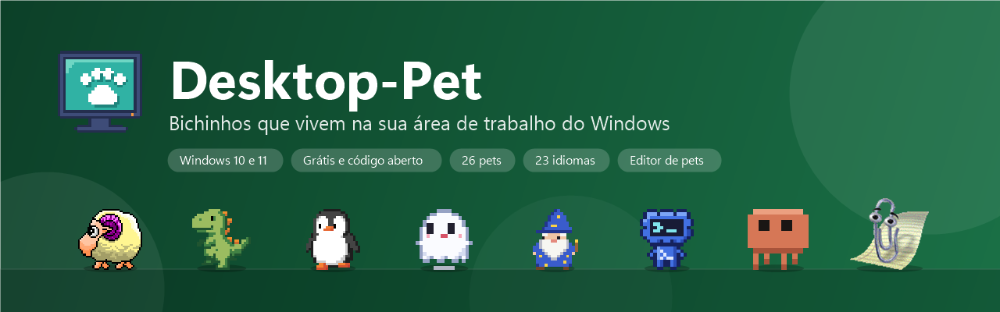
</p>

<p align="center"><b>English</b> · <a href="README.pt-BR.md">Português</a></p>

<p align="center">
  <a href="https://github.com/lfeliipeadv-stack/DeskPals/releases/latest"></a>
  <a href="https://github.com/lfeliipeadv-stack/DeskPals/releases"></a>
  
  
  
  <a href="LICENSE.md"></a>
</p>

<p align="center">
  <b>A little pet that lives on your desktop.</b><br>
  It walks along your windows, drops onto the taskbar, sleeps, dances, chats with you
  and reminds you to take breaks. You can drag it and toss it with the mouse — and make your own.
</p>

<p align="center">
  <a href="https://github.com/lfeliipeadv-stack/DeskPals/releases/latest/download/DesktopPet-Instalador.exe"><b>⬇️ Download for Windows (free)</b></a>
  &nbsp;·&nbsp;
  <a href="https://lfeliipeadv-stack.github.io/DeskPals/demo.html">🖥️ Try it in the browser</a>
  &nbsp;·&nbsp;
  <a href="https://lfeliipeadv-stack.github.io/DeskPals/wiki/Home.html">📖 Manual</a>
  &nbsp;·&nbsp;
  <a href="https://lfeliipeadv-stack.github.io/DeskPals/">🌐 Website</a>
</p>

---

## Contents

- [Try it before installing](#try-it-before-installing)
- [The pets](#the-pets)
- [What it does](#what-it-does)
- [Screenshots](#screenshots)
- [Install](#install)
- [Privacy](#privacy)
- [Quick questions](#quick-questions)
- [The manual](#the-manual)
- [Contributing](#contributing)
- [For developers](#for-developers)
- [Credits](#credits) · [License](#license)

## Try it before installing

The demo runs the real pet inside your browser, on a desktop that looks like Windows 11:
**[lfeliipeadv-stack.github.io/DeskPals/demo.html](https://lfeliipeadv-stack.github.io/DeskPals/demo.html)**

[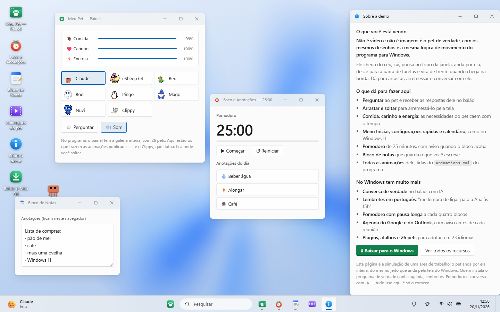](https://lfeliipeadv-stack.github.io/DeskPals/demo.html)

It isn't a video: it uses the same drawings, the same `animations.xml` and the same movement logic as the app. The pet
drops from the sky, lands on a window, walks along it and falls when the window goes away. You can drag it and toss it,
chat with it, switch pets (including Clippy, who floats), and use the Start menu, Pomodoro, the notepad, dark mode and
the wallpapers. The demo itself is in Portuguese.

## The pets

The gallery has **64 pets**, downloaded straight from this repository (the [`Pets`](Pets) folder) through the app's
panel, with an animated preview and the size of each one before you download it. The ones made for DeskPals, in pixel art:

<table>
  <tr>
    <td align="center" valign="top" width="25%">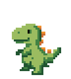<br><b>Rex</b><br><sub>A dinosaur that roars, plays ball, plays guitar and turns into a superhero. 195 animations, 24 sounds.</sub></td>
    <td align="center" valign="top" width="25%">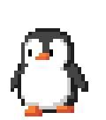<br><b>Pingo</b><br><sub>A penguin that belly-slides, skates, plays the trumpet and builds snowmen. 104 animations.</sub></td>
    <td align="center" valign="top" width="25%"><br><b>Boo</b><br><sub>A little ghost that flies around the screen, gives scares, vanishes and comes back. 403 animations, 120 sounds.</sub></td>
    <td align="center" valign="top" width="25%">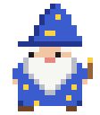<br><b>Mago</b><br><sub>A wizard who casts spells, teleports, flies on a broomstick and gets swallowed by his hat. 201 animations.</sub></td>
  </tr>
  <tr>
    <td align="center" valign="top">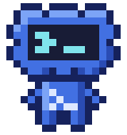<br><b>Nuvi</b><br><sub>A terminal cloud that codes, hits errors, compiles and makes thunder. 45 animations.</sub></td>
    <td align="center" valign="top">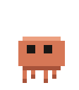<br><b>Claude</b><br><sub>A fan tribute to the Claude Code mascot (not affiliated with Anthropic). 45 animations.</sub></td>
    <td align="center" valign="top">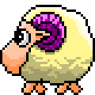<br><b>eSheep</b><br><sub>The classic little sheep. Built into the app and works offline.</sub></td>
    <td align="center" valign="top"><br><b>Pingus</b><br><sub>The penguins from the free game Pingus: they dig, explode and fly balloons. By Adriano Petrucci and Zecheriah.</sub></td>
  </tr>
</table>

**The community sheep** — the seven colorful gSheep and eSheep Mate, by Oliver B. and TheSuperCat, with 273 animations each:

<p>
  
  
  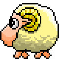
  
  
  
  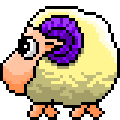
  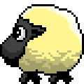
</p>

**The Office assistants** — Clippy, Merlin, Rover, Peedy, Genie, Genius, F1, Links, Rocky and Bonzi, with their original
animations and sounds. They have **no gravity**: they stay exactly where you drop them.

<p>
  
  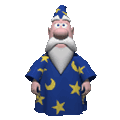
  
  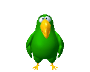
  
  
  
  
  
  
</p>

## What it does

<table>
<tr><td valign="top" width="50%">

**🐾 Every day**
- Walks along the top of your windows and falls when they disappear
- Drag and drop: it falls, bounces and walks again; throw it hard and it flies
- Middle-click the pet to pick any of its animations
- **Ctrl + Alt + P** hides every pet (and the sounds) — great for meetings
- Several pets at once, which greet each other when they meet
- 1×, 2× or 4× size, multiple monitors, light or dark theme

**💬 Ask the pet**
- Hover over it and click **Ask**: the answer shows up in a speech bubble
- Works with free services: Ollama (on your own computer), Google Gemini, Groq, OpenRouter or any compatible one
- Remembers the conversation, has personalities and accepts voice dictation
- The API key is encrypted for your Windows user only

**⏰ A work buddy**
- **Reminders** for water, stretching and breaks, and **Pomodoro** with the pet quiet while you focus
- **Written reminders**: "remind me to call Ana at 3pm", "every day at 8"
- **Calendar** from Google or Outlook: the pet warns you before every meeting
- **Weather forecast** on the Home page and rain alerts
- Suggests a break after a long stretch without stopping

</td><td valign="top" width="50%">

**🎨 Pet Editor**
- Make a pet from your own images or a GIF, in three steps
- Change any pet: sprite sheet, animations with live preview, sounds, entrances on screen
- Test on the desktop without touching your pet, with undo that survives closing the editor
- Export as .zip or **publish to the gallery** straight from the editor

**🧸 Virtual pet and games**
- It gets hungry, wants attention and gets sleepy — and (gently) complains
- Fortune cookies, jokes, a magic 8-ball and "how are you today?"
- Visits from butterflies, birds, bees and ladybugs

**🔌 Plugins and integrations**
- 22 plugins: CPU and memory monitor, shortcuts to folders and sites, notes, time spent in each app…
- Reacts to **Claude Code** (thinking, editing, done), and Claude can send you messages through the bubble (MCP)

**⚙️ Under the hood**
- A light app of about 3 MB: less than 1% CPU
- **23 languages**: Portuguese, English and Spanish built in, plus 20 to download in the settings
- **Automatic updates** in the background, verified with SHA-256 and installed when you close the app
- **Backup** of pets, reminders, notes and preferences, with an automatic copy to a folder (OneDrive, Google Drive)

</td></tr>
</table>

## Screenshots

Taken from the app itself (shown here in Portuguese; the app also runs in English, Spanish and 20 other languages).

<table>
  <tr>
    <td width="50%">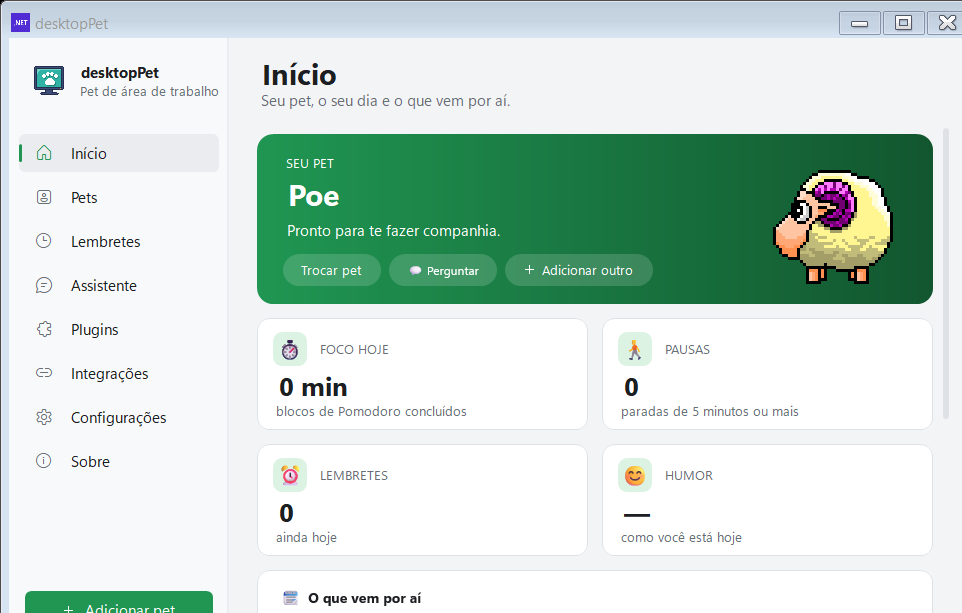<br><sub>Home: your pet, your day, your week and the weather forecast</sub></td>
    <td width="50%"><br><sub>My pets: the ones already on your computer</sub></td>
  </tr>
  <tr>
    <td>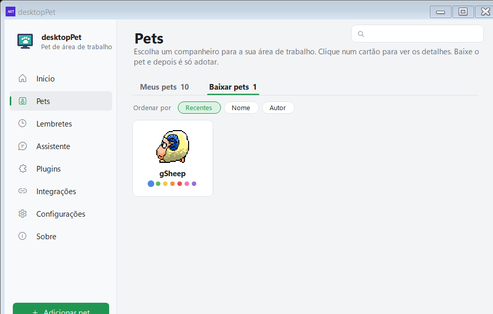<br><sub>Download pets: with a preview and the size of each one</sub></td>
    <td><br><sub>A pet's details, with its animations and sounds</sub></td>
  </tr>
  <tr>
    <td><br><sub>The conversation, in a bubble above the pet</sub></td>
    <td><br><sub>Reminders: water, stretching and your own notes</sub></td>
  </tr>
  <tr>
    <td><br><sub>Plugins: calendar, weather, focus and the rest</sub></td>
    <td>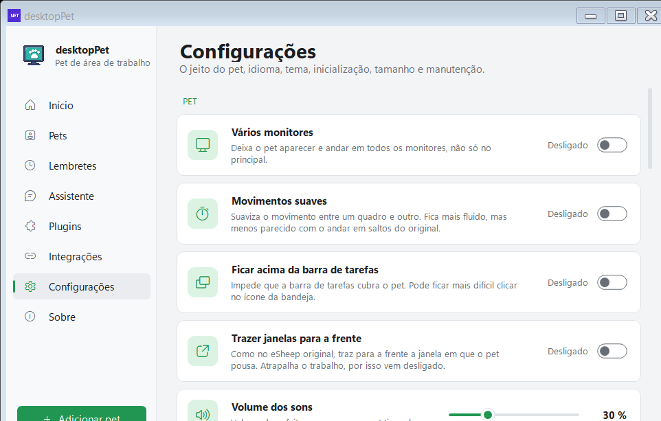<br><sub>Settings: sound, theme, language and shortcuts</sub></td>
  </tr>
  <tr>
    <td>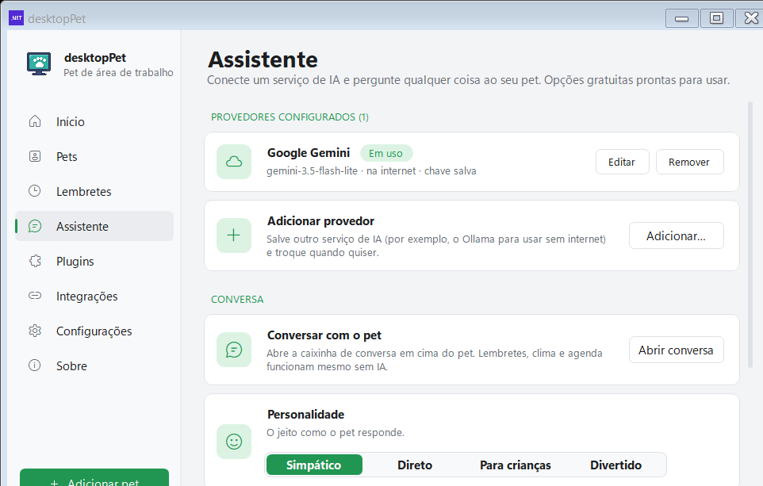<br><sub>Assistant: the AI that answers when you ask</sub></td>
    <td><br><sub>Pet Editor: your images become a pet, with a live preview</sub></td>
  </tr>
</table>

## Install

| File | Who it's for |
| --- | --- |
| **[DesktopPet-Instalador.exe](https://github.com/lfeliipeadv-stack/DeskPals/releases/latest/download/DesktopPet-Instalador.exe)** | **Recommended.** Checks for .NET 10 (and offers Microsoft's official installer if it's missing), installs the app and the Pet Editor in Program Files and creates the shortcuts. |
| [DesktopPet-completo.exe](https://github.com/lfeliipeadv-stack/DeskPals/releases/latest/download/DesktopPet-completo.exe) | Runs directly without installing anything: .NET is included (bigger file, about 50 MB). |
| [DesktopPet.exe](https://github.com/lfeliipeadv-stack/DeskPals/releases/latest/download/DesktopPet.exe) | Just the app, for those who already have the [.NET 10 Desktop Runtime](https://dotnet.microsoft.com/download/dotnet/10.0). |
| [PetEditor.exe](https://github.com/lfeliipeadv-stack/DeskPals/releases/latest/download/PetEditor.exe) | Just the Pet Editor (the app also downloads it on its own the first time you open the editor). |

Requires **Windows 10 or 11, 64-bit**. The installer asks for administrator permission once (to write to Program
Files); the app itself runs as a regular user. The icon appears next to the clock: right-click it and choose
**Open Panel** to adopt a pet. To uninstall, use **Apps** in Windows Settings — it asks whether you also want to delete
your pets and settings.

> The files aren't digitally signed, so Windows may warn that the publisher is unknown. Every release publishes
> `SHA256SUMS` so you can verify the download, and the app's updater checks everything on its own.

## Privacy

- **No account, no ads, no telemetry.** Your pets, reminders, notes and preferences stay on your computer.
- The app only uses the internet to download **pets, languages and updates** from this repository.
- The **weather forecast** sends only the name of the city you chose to Open-Meteo.
- **AI** is only used if you set up a service; with Ollama, everything stays on your computer.
- The AI key is encrypted for your Windows user and **never** goes into the backup.

## Quick questions

**Is it free?** Yes, and open source (MIT license).

**Will it slow my computer down?** No: the app is about 3 MB and uses less than 1% of the CPU.

**Does it work offline?** Yes. The classic sheep is built into the app, and pets you've already downloaded keep working.

**Can I use it during meetings?** **Ctrl + Alt + P** hides all pets and sounds; press it again to bring them back.

**Can I make my own pet?** Yes, with the Pet Editor — and send it to the gallery from the editor itself.

## The manual

The full manual is in the [project wiki](https://lfeliipeadv-stack.github.io/DeskPals/wiki/Home.html) (written in Portuguese):

| Page | What's in it |
| --- | --- |
| [Installation](https://lfeliipeadv-stack.github.io/DeskPals/wiki/Instalacao.html) | The downloads, what the installer checks, how to update and uninstall |
| [Getting started](https://lfeliipeadv-stack.github.io/DeskPals/wiki/Primeiros-passos.html) | What to do after installing, in order |
| [Browser demo](https://lfeliipeadv-stack.github.io/DeskPals/wiki/Demo-no-navegador.html) | The real pet running inside the page, nothing to install |
| [Pets panel](https://lfeliipeadv-stack.github.io/DeskPals/wiki/Painel-de-pets.html) | Downloading, adopting, removing, exporting and importing pets |
| [Ask the pet](https://lfeliipeadv-stack.github.io/DeskPals/wiki/Pergunte-ao-pet.html) | Chatting, the AI services and where the key is kept |
| [Reminders and Pomodoro](https://lfeliipeadv-stack.github.io/DeskPals/wiki/Lembretes-e-Pomodoro.html) | Written reminders and the focus mode that keeps the pet quiet |
| [Calendar and email](https://lfeliipeadv-stack.github.io/DeskPals/wiki/Agenda-e-e-mails.html) | Google and Outlook calendars and the email alerts |
| [Virtual pet and games](https://lfeliipeadv-stack.github.io/DeskPals/wiki/Pet-virtual-e-brinquedos.html) | Hunger, attention, sleep and the games |
| [Plugins and integrations](https://lfeliipeadv-stack.github.io/DeskPals/wiki/Plugins-e-integracoes.html) | The 22 plugins and the Claude Code bridge |
| [Make your pet](https://lfeliipeadv-stack.github.io/DeskPals/wiki/Crie-o-seu-pet.html) | The Pet Editor and the pet file format |
| [Shortcuts and commands](https://lfeliipeadv-stack.github.io/DeskPals/wiki/Atalhos-e-comandos.html) | Keyboard, mouse and the executable's arguments |
| [For developers](https://lfeliipeadv-stack.github.io/DeskPals/wiki/Para-desenvolvedores.html) | Building, testing and publishing a release |
| [FAQ](https://lfeliipeadv-stack.github.io/DeskPals/wiki/Perguntas-frequentes.html) | Common questions, answered |
| [Changelog](https://lfeliipeadv-stack.github.io/DeskPals/wiki/Changelog.html) | What changed in each version |

## Contributing

- **A new pet:** make it in the Pet Editor and use **Publish to gallery** — it prepares the .zip and opens the
  [pet form](https://github.com/lfeliipeadv-stack/DeskPals/issues/new?template=new_pet.md) already filled in.
- **A new or improved translation:** see [Languages/README.md](Languages/README.md).
- **A bug or an idea:** open an [issue](https://github.com/lfeliipeadv-stack/DeskPals/issues/new/choose).

The step-by-step guide is in [CONTRIBUTING.md](CONTRIBUTING.md).

## For developers

<details>
<summary>Build, test and publish</summary>

<br>

The app is C# (Windows Forms) on **.NET 10**; the Pet Editor is a separate program in the `editor/` folder.

```bash
dotnet build src/DesktopPet.Net.csproj -c Release
dotnet build editor/PetEditor.csproj -c Release
```

Self-test with the real code (results go to the file; the exit code is the number of failures;
`--only=name` runs only the tests with that name):

```bash
DesktopPet.exe --selftest=result.txt
PetEditor.exe --devtests=Pets
```

| Tool | What it does |
| --- | --- |
| [`Tools/PetGen`](Tools/PetGen) | Draws Rex, Pingo, Boo, Mago, Nuvi and Claude pixel by pixel and synthesizes their sounds |
| [`Tools/PetPack`](Tools/PetPack) | Builds pets from PNG frames |
| [`Tools/clippy-agents-to-pets.ps1`](Tools/clippy-agents-to-pets.ps1) | Converts the ClippyJS Office assistants into gravity-free pets |
| [`Tools/update-pets-json.ps1`](Tools/update-pets-json.ps1) | Updates each pet's size, animations and sounds in `Pets/pets.json` |
| [`Tools/make-previews.ps1`](Tools/make-previews.ps1) | Generates each pet's animated preview (`preview.gif`) with ffmpeg |
| [`Tools/make-readme-banner.ps1`](Tools/make-readme-banner.ps1) | Generates this README's banner with the gallery pets |
| [`Tools/update-languages-json.ps1`](Tools/update-languages-json.ps1) | Updates the list of downloadable languages (`Languages/languages.json`) |
| [`Tools/Setup`](Tools/Setup) | The installer (.NET Framework 4.8, checks for .NET 10) |
| [`Tools/release.ps1`](Tools/release.ps1) | Builds everything, runs the editor tests and publishes the release with `SHA256SUMS` |

```bash
pwsh Tools/release.ps1 -Version 1.0.1 -NoUpload    # build and check only, don't publish
```

Hold **CTRL** while opening the app (or use Settings → Debug window) to see live what the pet is doing.
More details in [For developers](https://lfeliipeadv-stack.github.io/DeskPals/wiki/Para-desenvolvedores.html) (in Portuguese).

</details>

## Credits

- **Original sheep idea and art:** Tatsutoshi Nomura (Stray Sheep, Fuji TV, 1994).
- **Original app:** [desktopPet](https://github.com/Adrianotiger/desktopPet) by Adriano Petrucci, the modern Windows version of the classic eSheep (MIT license).
- **Pet Editor idea:** [desktopPet-Editor](https://github.com/Adrianotiger/desktopPet-Editor), the online pet editor by Adriano Petrucci. DeskPals's Pet Editor was inspired by it and uses the same `animations.xml` format and schema.
- **System tray icon:** Sergi Fumanya Grunwaldt.
- **Pet throwing and collisions with windows and other pets:** Zecheriah.
- **.NET 10 version, translation, new pets and the Pet Editor app:** Luan Felipe.
- **Community pets:** Oliver B. (gSheep), TheSuperCat and Oliver B. (eSheep Mate), Adriano Petrucci and Zecheriah (Pingus). Each pet shows its author in the panel.
- **Pingus:** art and sounds from the free game [Pingus](https://pingus.seul.org/), under the GNU GPL.
- **Office assistants:** Clippy, Merlin, Rover, Peedy, Genie, Genius, F1, Links and Rocky are Microsoft characters, and Bonzi belongs to BONZI Software (characters, art and sounds). They were converted from [ClippyJS](https://github.com/pithings/clippy), whose code is MIT. Unofficial: not affiliated with these companies.
- **Weather forecast:** data from [Open-Meteo.com](https://open-meteo.com/); city names from [GeoNames.org](https://www.geonames.org/). Both under the Creative Commons Attribution 4.0 license (CC BY 4.0).

Claude is a fan tribute: the name, mascot and logo belong to Anthropic PBC, which is not affiliated with this
project. The Claude logo only identifies the Claude Code integration. In the app, credits and licenses are under **About**.

## License

[MIT](LICENSE.md) — use, modify and distribute freely, keeping the copyright notice.
