<p align="center">
  
</p>

<p align="center">
  <a href="https://github.com/lfeliipeadv-stack/meu-pet/releases/latest"></a>
  <a href="https://github.com/lfeliipeadv-stack/meu-pet/releases"></a>
  
  
  
  <a href="LICENSE.md"></a>
</p>

<p align="center">
  <b>Um bichinho que mora na sua área de trabalho.</b><br>
  Ele anda pelas suas janelas, cai na barra de tarefas, dorme, dança, conversa com você
  e lembra das pausas. Dá para arrastar e arremessar com o mouse — e criar o seu próprio.
</p>

<p align="center">
  <a href="https://github.com/lfeliipeadv-stack/meu-pet/releases/latest/download/DesktopPet-Instalador.exe"><b>⬇️ Baixar para Windows (grátis)</b></a>
  &nbsp;·&nbsp;
  <a href="https://lfeliipeadv-stack.github.io/meu-pet/demo.html">🖥️ Testar no navegador</a>
  &nbsp;·&nbsp;
  <a href="https://lfeliipeadv-stack.github.io/meu-pet/wiki/Home.html">📖 Manual</a>
  &nbsp;·&nbsp;
  <a href="https://lfeliipeadv-stack.github.io/meu-pet/">🌐 Página do projeto</a>
</p>

---

## Sumário

- [Teste antes de instalar](#teste-antes-de-instalar)
- [Os pets](#os-pets)
- [O que ele faz](#o-que-ele-faz)
- [Telas](#telas)
- [Instalar](#instalar)
- [Privacidade](#privacidade)
- [Perguntas rápidas](#perguntas-rápidas)
- [O manual](#o-manual)
- [Contribuir](#contribuir)
- [Para desenvolvedores](#para-desenvolvedores)
- [Créditos](#créditos) · [Licença](#licença)

## Teste antes de instalar

A demo roda o pet de verdade dentro do navegador, numa área de trabalho com a cara do Windows 11:
**[lfeliipeadv-stack.github.io/meu-pet/demo.html](https://lfeliipeadv-stack.github.io/meu-pet/demo.html)**

[](https://lfeliipeadv-stack.github.io/meu-pet/demo.html)

Não é vídeo: são os mesmos desenhos, o mesmo `animations.xml` e a mesma lógica de movimento do programa. O pet
chega do céu, pousa numa janela, anda por ela e cai quando ela some. Dá para arrastar e arremessar, conversar,
trocar de pet (inclusive o Clippy, que flutua), usar o Iniciar, o Pomodoro, o bloco de notas, o tema escuro e os
papéis de parede. [Mais sobre a demo](https://lfeliipeadv-stack.github.io/meu-pet/wiki/Demo-no-navegador.html).

## Os pets

A galeria tem **26 pets**, baixados direto deste repositório (pasta [`Pets`](Pets)) pelo painel do programa,
com a prévia animada e o tamanho de cada um antes de baixar. Os feitos para o Meu Pet, em pixel art:

<table>
  <tr>
    <td align="center" valign="top" width="25%">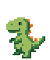<br><b>Rex</b><br><sub>Dinossauro que ruge, joga bola, toca guitarra e vira super-herói. 195 animações, 24 sons.</sub></td>
    <td align="center" valign="top" width="25%"><br><b>Pingo</b><br><sub>Pinguim que desliza de barriga, patina, toca trompete e faz boneco de neve. 104 animações.</sub></td>
    <td align="center" valign="top" width="25%"><br><b>Boo</b><br><sub>Fantasminha que voa pela tela, dá sustos, some e reaparece. 403 animações, 120 sons.</sub></td>
    <td align="center" valign="top" width="25%"><br><b>Mago</b><br><sub>Faz feitiços, se teletransporta, voa de vassoura e é engolido pelo chapéu. 201 animações.</sub></td>
  </tr>
  <tr>
    <td align="center" valign="top">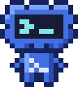<br><b>Nuvi</b><br><sub>Nuvem-terminal que programa, dá erro, compila e faz trovão. 45 animações.</sub></td>
    <td align="center" valign="top"><br><b>Claude</b><br><sub>Homenagem de fã ao mascote do Claude Code (sem vínculo com a Anthropic). 45 animações.</sub></td>
    <td align="center" valign="top"><br><b>eSheep</b><br><sub>A ovelhinha clássica. Vem dentro do programa e funciona sem internet.</sub></td>
    <td align="center" valign="top">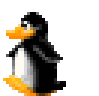<br><b>Pingus</b><br><sub>Os pinguins do jogo livre Pingus: cavam, explodem e voam de balão. De Adriano Petrucci e Zecheriah.</sub></td>
  </tr>
</table>

**As ovelhas da comunidade** — as sete gSheep coloridas e o eSheep Mate, de Oliver B. e TheSuperCat, com 273 animações cada:

<p>
  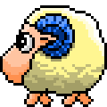
  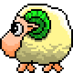
  
  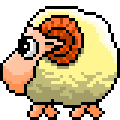
  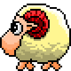
  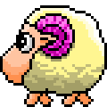
  
  
</p>

**Os assistentes do Office** — Clippy, Merlin, Rover, Peedy, Genie, Genius, F1, Links, Rocky e Bonzi, com as animações
e os sons originais. Eles **não têm gravidade**: ficam exatamente onde você soltar.

<p>
  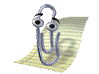
  
  
  
  
  
  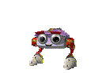
  
  
  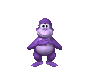
</p>

## O que ele faz

<table>
<tr><td valign="top" width="50%">

**🐾 No dia a dia**
- Anda pelo topo das janelas e cai quando elas somem
- Arraste e solte: ele cai, quica e volta a andar; com força, ele voa
- Botão do meio no pet: escolha qualquer animação dele
- **Ctrl + Alt + P** esconde todos os pets (e os sons) — ótimo em reuniões
- Vários pets ao mesmo tempo, que se cumprimentam quando se encontram
- Tamanho 1×, 2× ou 4×, vários monitores, tema claro ou escuro

**💬 Pergunte ao pet**
- Passe o mouse sobre ele e clique em **Perguntar**: a resposta aparece no balão
- Funciona com serviços gratuitos: Ollama (no seu computador), Google Gemini, Groq, OpenRouter ou outro compatível
- Lembra a conversa, tem personalidades e aceita ditado por voz
- A chave fica criptografada só para o seu usuário do Windows

**⏰ Companhia no trabalho**
- **Lembretes** de água, alongamento e pausa, e **Pomodoro** com o pet em silêncio durante o foco
- **Lembretes escritos**: "me lembra de ligar para a Ana às 15h", "todo dia às 8"
- **Agenda** do Google ou do Outlook: o pet avisa antes de cada reunião
- **Previsão do tempo** no Início e aviso de chuva
- Sugere uma pausa depois de muito tempo sem parar

</td><td valign="top" width="50%">

**🎨 Editor de Pets**
- Crie um pet a partir das suas imagens ou de um GIF, em três passos
- Mude qualquer pet: folha de sprites, animações com prévia ao vivo, sons, entradas na tela
- Teste no desktop sem mexer no seu pet, com desfazer que continua depois de fechar
- Exporte em .zip ou **publique na galeria** direto do editor

**🧸 Pet virtual e brincadeiras**
- Ele sente fome, quer carinho e tem sono — e reclama (de leve)
- Biscoito da sorte, piadas, bola 8 mágica e "como você está hoje?"
- Visitas de borboletas, pássaros, abelhas e joaninhas

**🔌 Plugins e integrações**
- 22 plugins: monitor de CPU e memória, atalhos para pastas e sites, notas, tempo em cada programa…
- Reage ao **Claude Code** (pensando, editando, pronto) e o Claude pode mandar recados pelo balão (MCP)

**⚙️ Por baixo**
- Programa de cerca de 3 MB, leve: menos de 1% de CPU
- **23 idiomas**: português, inglês e espanhol, mais 20 para baixar nas configurações
- **Atualização automática** em segundo plano, conferida por SHA-256, instalada ao fechar
- **Backup** de pets, lembretes, notas e preferências, com cópia automática numa pasta (OneDrive, Google Drive)

</td></tr>
</table>

## Telas

Tiradas do próprio programa.

<table>
  <tr>
    <td width="50%"><br><sub>Início: seu pet, o dia, a semana e a previsão do tempo</sub></td>
    <td width="50%">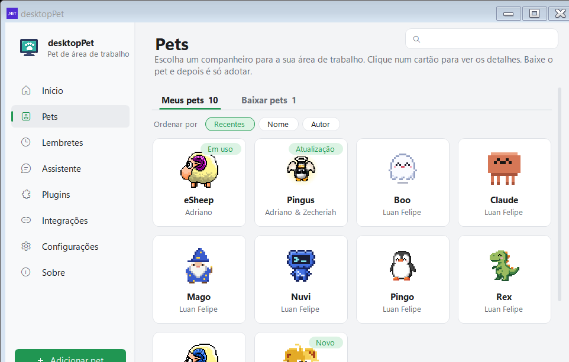<br><sub>Meus pets: o que já está no seu computador</sub></td>
  </tr>
  <tr>
    <td><br><sub>Baixar pets: com a prévia e o tamanho de cada um</sub></td>
    <td>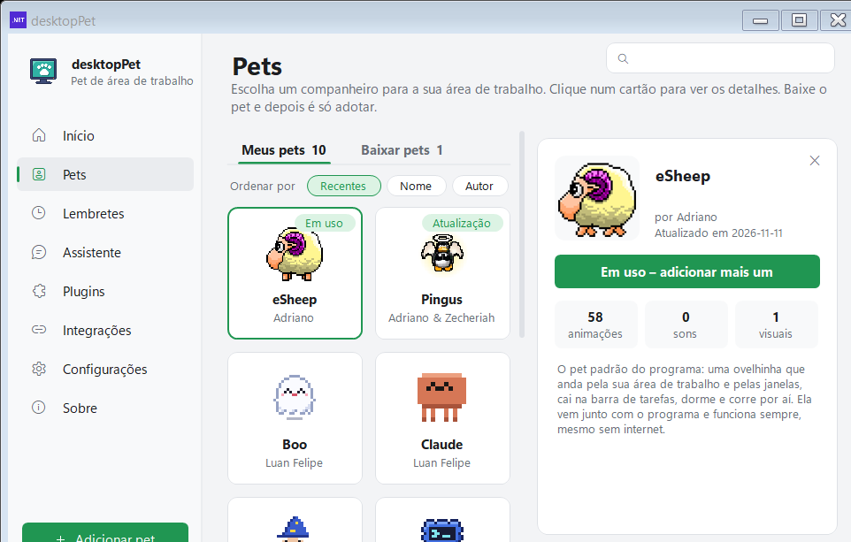<br><sub>O detalhe do pet, com as animações e os sons</sub></td>
  </tr>
  <tr>
    <td>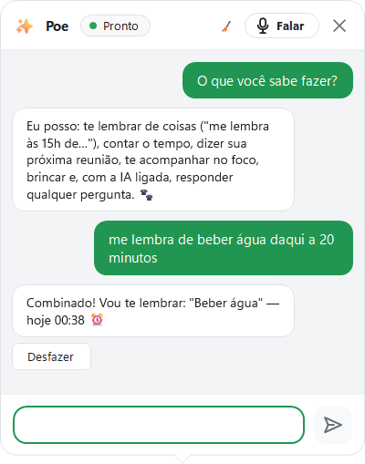<br><sub>A conversa, no balão sobre o pet</sub></td>
    <td>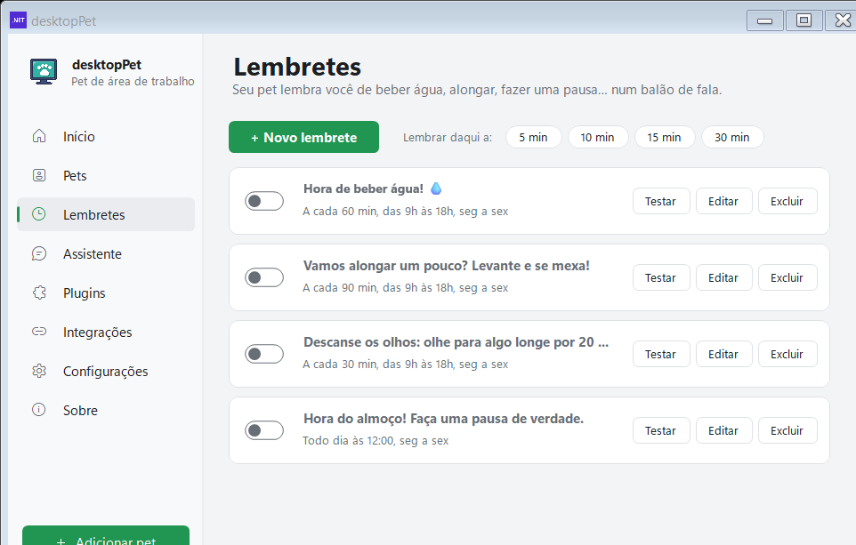<br><sub>Lembretes: água, alongamento e as suas anotações</sub></td>
  </tr>
  <tr>
    <td>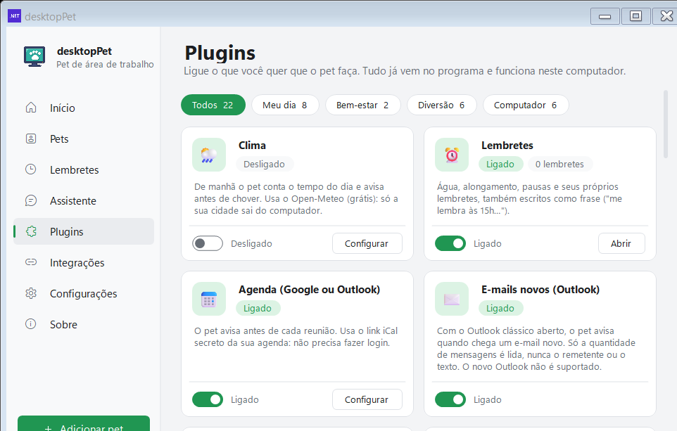<br><sub>Plugins: agenda, clima, foco e os outros</sub></td>
    <td><br><sub>Configurações: som, tema, idioma e atalhos</sub></td>
  </tr>
  <tr>
    <td><br><sub>Assistente: a IA que responde quando você pergunta</sub></td>
    <td>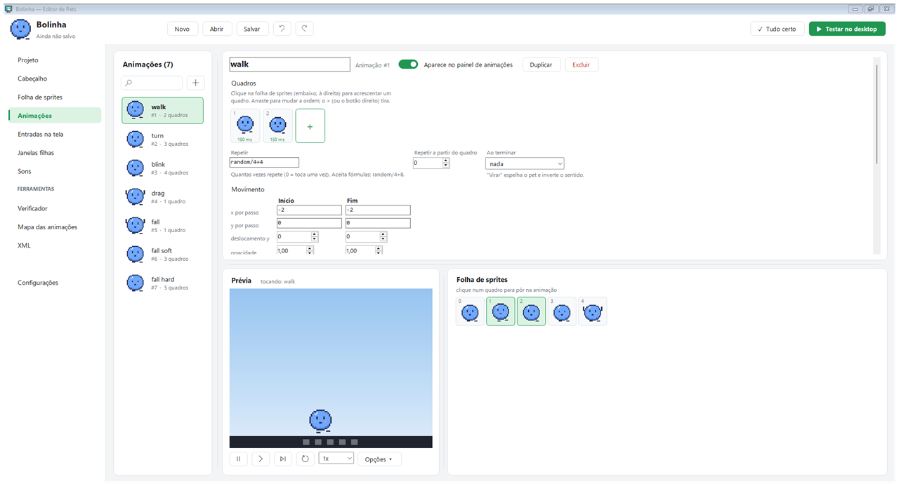<br><sub>Editor de Pets: as suas imagens viram um bichinho, com prévia ao vivo</sub></td>
  </tr>
</table>

## Instalar

| Arquivo | Para quem |
| --- | --- |
| **[DesktopPet-Instalador.exe](https://github.com/lfeliipeadv-stack/meu-pet/releases/latest/download/DesktopPet-Instalador.exe)** | **Recomendado.** Confere o .NET 10 (e oferece o instalador oficial da Microsoft se faltar), instala o programa e o Editor de Pets em Arquivos de Programas e cria os atalhos. |
| [DesktopPet-completo.exe](https://github.com/lfeliipeadv-stack/meu-pet/releases/latest/download/DesktopPet-completo.exe) | Abre direto, sem instalar nada: o .NET vem dentro (arquivo maior, cerca de 50 MB). |
| [DesktopPet.exe](https://github.com/lfeliipeadv-stack/meu-pet/releases/latest/download/DesktopPet.exe) | Só o programa, para quem já tem o [.NET 10 Desktop Runtime](https://dotnet.microsoft.com/download/dotnet/10.0). |
| [PetEditor.exe](https://github.com/lfeliipeadv-stack/meu-pet/releases/latest/download/PetEditor.exe) | Só o Editor de Pets (o programa também o baixa sozinho na primeira vez que você abre o editor). |

Precisa de **Windows 10 ou 11, 64 bits**. O instalador pede permissão de administrador uma vez (para gravar em
Arquivos de Programas); o programa roda como usuário comum. O ícone aparece perto do relógio: clique com o botão direito e escolha
**Abrir Painel** para adotar um pet. Para desinstalar, use **Aplicativos** nas Configurações do Windows — ele pergunta
se você quer apagar também seus pets e configurações. O passo a passo está em
[Instalação](https://lfeliipeadv-stack.github.io/meu-pet/wiki/Instalacao.html).

> Os arquivos não têm assinatura digital, então o Windows pode avisar que o editor é desconhecido. Cada versão
> publica o `SHA256SUMS` para conferir o download, e o atualizador do programa confere tudo sozinho.

## Privacidade

- **Nada de conta, anúncio ou telemetria.** Seus pets, lembretes, notas e preferências ficam no seu computador.
- O programa só usa a internet para baixar **pets, idiomas e atualizações** deste repositório.
- A **previsão do tempo** envia só o nome da cidade que você escolheu ao Open-Meteo.
- A **IA** só é usada se você configurar um serviço; com o Ollama, tudo fica no seu computador.
- A chave da IA fica criptografada para o seu usuário do Windows e **nunca** entra no backup.

## Perguntas rápidas

**É grátis?** Sim, e de código aberto (licença MIT).

**Pesa no computador?** Não: o programa tem cerca de 3 MB e usa menos de 1% do processador.

**Funciona sem internet?** Sim. A ovelha clássica vem dentro do programa, e os pets já baixados continuam funcionando.

**Dá para usar em reunião?** **Ctrl + Alt + P** esconde todos os pets e os sons; aperte de novo para voltar.

**Posso fazer o meu pet?** Sim, com o Editor de Pets — e mandar para a galeria pelo próprio editor.

Mais respostas em [Perguntas frequentes](https://lfeliipeadv-stack.github.io/meu-pet/wiki/Perguntas-frequentes.html).

## O manual

O manual inteiro está no [Wiki do projeto](https://lfeliipeadv-stack.github.io/meu-pet/wiki/Home.html):

| Página | O que tem |
| --- | --- |
| [Instalação](https://lfeliipeadv-stack.github.io/meu-pet/wiki/Instalacao.html) | Os downloads, o que o instalador confere, como atualizar e desinstalar |
| [Primeiros passos](https://lfeliipeadv-stack.github.io/meu-pet/wiki/Primeiros-passos.html) | O que fazer depois de instalar, em ordem |
| [Demo no navegador](https://lfeliipeadv-stack.github.io/meu-pet/wiki/Demo-no-navegador.html) | O pet de verdade rodando dentro da página, sem instalar nada |
| [Painel de pets](https://lfeliipeadv-stack.github.io/meu-pet/wiki/Painel-de-pets.html) | Baixar, adotar, remover, exportar e importar pets |
| [Pergunte ao pet](https://lfeliipeadv-stack.github.io/meu-pet/wiki/Pergunte-ao-pet.html) | A conversa, os serviços de IA e onde fica a chave |
| [Lembretes e Pomodoro](https://lfeliipeadv-stack.github.io/meu-pet/wiki/Lembretes-e-Pomodoro.html) | Os lembretes escritos em português e o foco que silencia o pet |
| [Agenda e e-mails](https://lfeliipeadv-stack.github.io/meu-pet/wiki/Agenda-e-e-mails.html) | A agenda do Google e do Outlook e os avisos de e-mail |
| [Pet virtual e brincadeiras](https://lfeliipeadv-stack.github.io/meu-pet/wiki/Pet-virtual-e-brinquedos.html) | Fome, carinho, sono e as brincadeiras |
| [Plugins e integrações](https://lfeliipeadv-stack.github.io/meu-pet/wiki/Plugins-e-integracoes.html) | Os 22 plugins e a ponte com o Claude Code |
| [Crie o seu pet](https://lfeliipeadv-stack.github.io/meu-pet/wiki/Crie-o-seu-pet.html) | O Editor de Pets e o formato do arquivo do pet |
| [Atalhos e comandos](https://lfeliipeadv-stack.github.io/meu-pet/wiki/Atalhos-e-comandos.html) | Teclado, mouse e os argumentos do executável |
| [Para desenvolvedores](https://lfeliipeadv-stack.github.io/meu-pet/wiki/Para-desenvolvedores.html) | Compilar, testar e publicar uma versão |
| [Perguntas frequentes](https://lfeliipeadv-stack.github.io/meu-pet/wiki/Perguntas-frequentes.html) | Dúvidas comuns, respondidas |
| [Changelog](https://lfeliipeadv-stack.github.io/meu-pet/wiki/Changelog.html) | O que mudou em cada versão |

## Contribuir

- **Um pet novo:** faça no Editor de Pets e use **Publicar na galeria** — ele prepara o .zip e abre o
  [formulário de pet](https://github.com/lfeliipeadv-stack/meu-pet/issues/new?template=new_pet.md) já preenchido.
- **Uma tradução** nova ou corrigida: veja [Languages/README.md](Languages/README.md).
- **Um problema ou uma ideia:** abra uma [issue](https://github.com/lfeliipeadv-stack/meu-pet/issues/new/choose).

O passo a passo está em [CONTRIBUTING.md](CONTRIBUTING.md).

## Para desenvolvedores

<details>
<summary>Compilar, testar e publicar</summary>

<br>

O programa é C# (Windows Forms) sobre **.NET 10**; o Editor de Pets é um programa à parte, na pasta `editor/`.

```bash
dotnet build src/DesktopPet.Net.csproj -c Release
dotnet build editor/PetEditor.csproj -c Release
```

Autoteste com o código de verdade (o resultado vai para o arquivo; o código de saída é o número de falhas;
`--only=nome` roda só os testes com esse nome):

```bash
DesktopPet.exe --selftest=resultado.txt
PetEditor.exe --devtests=Pets
```

| Ferramenta | O que faz |
| --- | --- |
| [`Tools/PetGen`](Tools/PetGen) | Desenha Rex, Pingo, Boo, Mago, Nuvi e Claude pixel a pixel e sintetiza os sons |
| [`Tools/PetPack`](Tools/PetPack) | Monta pets a partir de quadros PNG |
| [`Tools/clippy-agents-to-pets.ps1`](Tools/clippy-agents-to-pets.ps1) | Converte os assistentes do Office do ClippyJS em pets sem gravidade |
| [`Tools/update-pets-json.ps1`](Tools/update-pets-json.ps1) | Atualiza tamanho, animações e sons de cada pet no `Pets/pets.json` |
| [`Tools/make-previews.ps1`](Tools/make-previews.ps1) | Gera a prévia animada (`preview.gif`) de cada pet com o ffmpeg |
| [`Tools/make-readme-banner.ps1`](Tools/make-readme-banner.ps1) | Gera o banner deste README com os pets da galeria |
| [`Tools/update-languages-json.ps1`](Tools/update-languages-json.ps1) | Atualiza a lista dos idiomas para baixar (`Languages/languages.json`) |
| [`Tools/Setup`](Tools/Setup) | O instalador (.NET Framework 4.8, confere o .NET 10) |
| [`Tools/release.ps1`](Tools/release.ps1) | Compila tudo, roda os testes do editor e publica a versão com o `SHA256SUMS` |

```bash
pwsh Tools/release.ps1 -Version 1.0.1 -NoUpload    # só monta e confere, sem publicar
```

Segure **CTRL** ao abrir o programa (ou use Configurações → Janela de depuração) para ver ao vivo o que o pet está
fazendo. Os detalhes estão em [Para desenvolvedores](https://lfeliipeadv-stack.github.io/meu-pet/wiki/Para-desenvolvedores.html).

</details>

## Créditos

- **Ideia e arte originais da ovelha:** Tatsutoshi Nomura (Stray Sheep, Fuji TV, 1994).
- **Programa original:** [desktopPet](https://github.com/Adrianotiger/desktopPet) de Adriano Petrucci, a versão para Windows moderno da ovelhinha clássica do eSheep (licença MIT).
- **Ícone na bandeja do sistema:** Sergi Fumanya Grunwaldt.
- **Arremesso do pet e colisões com janelas e outros pets:** Zecheriah.
- **Versão .NET 10, tradução, pets novos e Editor de Pets:** Luan Felipe.
- **Pets da comunidade:** Oliver B. (gSheep), TheSuperCat e Oliver B. (eSheep Mate), Adriano Petrucci e Zecheriah (Pingus). Cada pet mostra o autor no painel.
- **Pingus:** arte e sons do jogo livre [Pingus](https://pingus.seul.org/), sob a licença GNU GPL.
- **Assistentes do Office:** Clippy, Merlin, Rover, Peedy, Genie, Genius, F1, Links e Rocky são personagens da Microsoft, e o Bonzi é da BONZI Software (personagens, arte e sons). Foram convertidos do [ClippyJS](https://github.com/pithings/clippy), cujo código é MIT. Não oficiais: sem vínculo com essas empresas.
- **Previsão do tempo:** dados do [Open-Meteo.com](https://open-meteo.com/); nomes das cidades do [GeoNames.org](https://www.geonames.org/). Os dois sob a licença Creative Commons Atribuição 4.0 (CC BY 4.0).

O Claude é uma homenagem de fã: o nome, o mascote e o logotipo pertencem à Anthropic PBC, que não tem vínculo com este
projeto. O logotipo do Claude só identifica a integração com o Claude Code. No programa, os créditos e as licenças
ficam em **Sobre**.

## Licença

[MIT](LICENSE.md) — use, modifique e distribua à vontade, mantendo o aviso de copyright.
