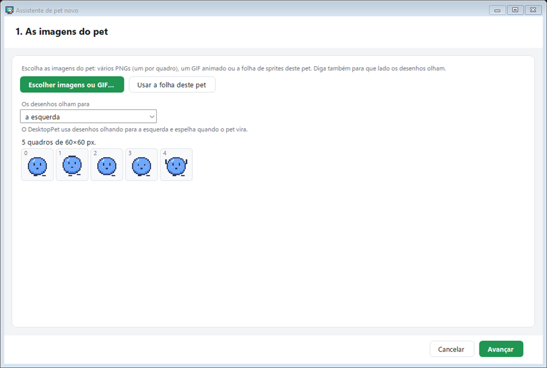
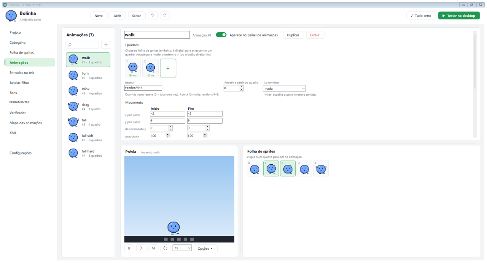

# Crie o seu pet

O Desktop-Pet vem com o **Editor de Pets** (`PetEditor.exe`), um programa à parte para criar um pet a partir das suas imagens ou mudar um que já existe: imagens, animações, entradas na tela, sons, com prévia ao vivo. O pet criado anda, vira, dorme, cai e pode ser arremessado como os outros.

[Home](Home.md) · [Instalação](Instalacao.md) · [Primeiros passos](Primeiros-passos.md) · [Painel de pets](Painel-de-pets.md) · [Pergunte ao pet](Pergunte-ao-pet.md) · [Lembretes e pomodoro](Lembretes-e-pomodoro.md) · [Agenda e e-mails](Agenda-e-e-mails.md) · [Pet virtual e brinquedos](Pet-virtual-e-brinquedos.md) · [Plugins e integrações](Plugins-e-integracoes.md) · [Atalhos e comandos](Atalhos-e-comandos.md) · [Para desenvolvedores](Para-desenvolvedores.md) · [Perguntas frequentes](Perguntas-frequentes.md) · [Changelog](Changelog.md)

## Abrir o Editor de Pets

- **Pelo programa:** **Configurações › Programa › Editor de Pets › Abrir…**. Se o editor ainda não estiver no computador (quem baixou só o `DesktopPet.exe`), o programa baixa o `PetEditor.exe` da última versão publicada, confere o SHA-256 dele contra o `SHA256SUMS` e abre.
- **Pelo instalador:** o `DesktopPet-Instalador.exe` já instala o editor ao lado do programa, com atalho próprio.
- **Direto:** o `PetEditor.exe` também está na página de versões: <https://github.com/lfeliipeadv-stack/meu-pet/releases/latest>. Ele precisa do .NET 10 Desktop Runtime, como o `DesktopPet.exe`.

O editor abre na página **Projeto**, sem nenhum pet carregado. Ali ficam as ações (Assistente de pet novo, Novo pet, Abrir arquivo, Abrir pasta, Salvar como, Exportar como .zip e Publicar na galeria), os pets **abertos recentemente** e os **pets baixados no DesktopPet**, em cartões com a imagem de cada um. Um clique num cartão abre o pet. Quem prefere o jeito antigo liga **Abrir o último pet ao iniciar** nas Configurações do editor.

## Criar um pet com o assistente

O **Assistente de pet novo** monta um pet completo em três passos:



*O primeiro passo do assistente: os quadros escolhidos e para que lado os desenhos olham.*

1. **As imagens.** **Escolher imagens ou GIF…** carrega os quadros (vários PNG ou um GIF animado); **Usar a folha deste pet** aproveita a folha de sprites do pet aberto. Diga para que lado os desenhos olham: o DesktopPet usa desenhos olhando para a esquerda e espelha quando o pet vira, então desenhos virados para a direita são espelhados.
2. **Os movimentos.** Para cada movimento (andar, parado, cair, ser pego…), clique nos quadros na ordem. Os movimentos obrigatórios pedem um número mínimo de quadros; os outros são opcionais.
3. **O jeito do pet.** A velocidade (devagar, normal ou rápido) e se ele sobe pelas laterais da tela.

**Criar o pet** gera o `animations.xml`. O pet vai andar, virar nas laterais, cair do céu, ser pego com o mouse e, de vez em quando, fazer as outras animações escolhidas.

## As páginas do editor



*A página Animações: cada animação com os quadros, o movimento, a prévia ao vivo e a folha de sprites.*

| Página | O que faz |
| --- | --- |
| Projeto | Novo, abrir, salvar, exportar, publicar, os recentes e os pets baixados |
| Cabeçalho | Nome, título, autor, versão, descrição e ícone do pet |
| Folha de sprites | A imagem com todos os quadros e como ela é cortada; o editor de pixels e o otimizador (tira quadros sem uso e diminui o PNG) |
| Animações | Cada animação com os quadros, o movimento, a velocidade, o que vem depois e a prévia ao vivo |
| Entradas na tela | Por onde o pet aparece (pela lateral, caindo do céu…) |
| Janelas filhas | As janelas extras que uma animação abre (uma banheira, um balão, fumaça) |
| Sons | Os MP3 tocados por cada animação |
| Verificador | Erros e avisos do pet, com um clique para ir até o problema |
| Mapa das animações | O caminho de uma animação para a outra |
| XML | O `animations.xml` como texto, para editar à mão |

Atalhos: **Ctrl+N** novo, **Ctrl+O** abrir, **Ctrl+S** salvar, **Ctrl+Shift+S** salvar como, **Ctrl+Z** desfazer, **Ctrl+Y** refazer e **F5** testar no desktop.

O **desfazer** continua depois de fechar o editor: ao salvar, os últimos 30 passos ficam guardados junto do projeto, e voltam quando o mesmo arquivo é aberto de novo (se ele não foi mudado por fora). E, se o editor fechar sem salvar, a próxima abertura oferece recuperar o trabalho.

## Testar no desktop

**Testar no desktop** (ou **F5**) abre um segundo DesktopPet só com este pet. Ele não mexe no seu pet nem nas suas configurações e recarrega sozinho quando você muda algo no editor. Para encerrar, use o ícone de teste na bandeja ou feche o editor.

## Usar o pet no programa

O DesktopPet mostra na aba **Meus pets** todo pet guardado em `%LocalAppData%\DesktopPet\pets\`. Para adotar o seu pet, salve-o com **Salvar como** numa pasta com o prefixo `meu-` dentro dela, por exemplo `%LocalAppData%\DesktopPet\pets\meu-bolinha\animations.xml`. O prefixo `meu-` marca o pet como criado neste computador: ele nunca é apagado como os da galeria, aparece com a frase **"Você criou este pet neste computador. Ele vai junto nos seus backups."** e entra sozinho no backup.

### O backup

Em **Configurações › Programa › Backup dos meus pets e configurações › Exportar…**, o arquivo `.desktoppet` leva `pets/<pasta>/animations.xml` e `version.txt` de cada pet do computador, incluindo os que você criou, e também os lembretes, as notas, os atalhos, o histórico de humor, o tempo em cada programa, as necessidades do pet virtual e as preferências. A chave do serviço de IA e os tokens nunca entram nele. **Importar backup** traz tudo de volta: só entram entradas `pets/<nome>/animations.xml` com nome de pasta simples e até 50 MB, e um arquivo corrompido nunca substitui um bom. A **Cópia automática** grava esse arquivo uma vez por dia numa pasta à sua escolha.

## Mandar o pet para alguém ou para a galeria

- **Exportar como .zip** gera um arquivo só, pronto para mandar: a pasta do pet com `animations.xml`, `icon.png`, a prévia animada (`preview.gif`) e os READMEs em inglês e português.
- **Publicar na galeria** confere o pet (precisa de nome, autor e nenhum erro no Verificador), cria o .zip em `Documentos\Desktop-Pet\galeria` e abre a página de envio do GitHub já preenchida. O GitHub não recebe arquivos por link: o .zip aparece selecionado no Explorador para você arrastar até a página e clicar em **Submit new issue**. Quem cuida da galeria confere o pet antes de ele aparecer para todos.

## Para ir além: o animations.xml, PetGen e PetPack

O Editor de Pets cobre o pet inteiro. Esta parte é para quem quer entender o arquivo por dentro ou gerar pets em lote com as ferramentas de linha de comando.

### O formato animations.xml

O arquivo que descreve o pet inteiro é o `animations.xml`, e o programa usa o mesmo esquema do eSheep original, com o namespace `https://esheep.petrucci.ch/`. O esquema completo está em `Resources/animations.xsd`. O [Editor de Pets](#abrir-o-editor-de-pets) edita esse arquivo com prévia ao vivo, e a página **XML** dele mostra o texto para editar à mão.

A raiz é `<animations>` e, dentro dela, esta ordem:

| Bloco | O que guarda |
| --- | --- |
| `<header>` | `author`, `title`, `petname` (máximo 16 caracteres, o programa corta o que sobrar), `version`, `info`, `application`, `icon` (ícone `.ico` em base64) e, opcional, `floating` (`yes`: o pet não tem gravidade e fica onde for solto, como os assistentes do Office) |
| `<image>` | `tilesx` e `tilesy` (como a folha de sprites é cortada), `skins` (opcional), `png` (a folha de sprites em base64) e `transparency` |
| `<spawns>` | Os pontos de entrada do pet na tela, cada `<spawn>` com `probability`, `<x>`, `<y>` e `<next>` |
| `<animations>` | Cada `<animation>` com `id`, `<name>`, `<start>`, `<end>`, `<sequence>`, e opcionalmente `<border>` e `<gravity>` |
| `<childs>` | As janelas extras que uma animação pode abrir (uma banheira, um balão) |
| `<sounds>` | Os MP3 em base64, cada `<sound>` com `animationid`, `probability`, `loop` e `base64>` |

Um cabeçalho mínimo:

```xml
<?xml version="1.0" encoding="utf-8"?>
<animations xmlns="https://esheep.petrucci.ch/">
  <header>
    <author>Luan Felipe</author>
    <title>Meu pet</title>
    <petname>Meu pet</petname>
    <version>1.0</version>
    <info>Um bichinho que anda pela sua area de trabalho.</info>
    <application>1</application>
    <icon><![CDATA[AAABAAQAEBAAAAEAI...]]></icon>
  </header>
  <image>
    <tilesx>8</tilesx>
    <tilesy>3</tilesy>
    <png><![CDATA[iVBORw0KGgoAAAANSUhEUg...]]></png>
    <transparency>Magenta</transparency>
  </image>
  <spawns>
    <spawn id="1" probability="60">
      <x>screenW+10</x>
      <y>areaH-imageH</y>
      <next>1</next>
    </spawn>
  </spawns>
  <animations>
    <!-- as animacoes vao aqui -->
  </animations>
  <childs />
  <sounds />
</animations>
```

Uma animação completa, com o bloco de borda e o de gravidade:

```xml
<animation id="1">
  <name>walk</name>
  <start>
    <x>-3</x>
    <y>0</y>
    <offsety>0</offsety>
    <opacity>1</opacity>
    <interval>150</interval>
  </start>
  <end>
    <x>-3</x>
    <y>0</y>
    <offsety>0</offsety>
    <opacity>1</opacity>
    <interval>150</interval>
  </end>
  <sequence repeatfrom="0" repeat="random/4+8">
    <frame>7</frame>
    <frame>8</frame>
    <frame>9</frame>
    <frame>8</frame>
    <next probability="50" only="none">1</next>
    <next probability="8" only="none">2</next>
    <next probability="10" only="none">11</next>
  </sequence>
  <border>
    <next probability="100" only="none">2</next>
  </border>
  <gravity>
    <next probability="100" only="none">5</next>
  </gravity>
</animation>
```

Como ler isso:

- `<start>` e `<end>` são os dois extremos do movimento (x, y, offsety, opacity, interval). Tudo entre eles é interpolado ao longo dos passos da sequência. Um `<x>` negativo anda para a esquerda.
- `<interval>` é o tempo de cada quadro em milissegundos, e é ele que define a velocidade.
- `<sequence>` traz a lista de `<frame>` — os índices dos quadros na folha de sprites. `repeat` é quantas vezes a sequência repete (`0` ou `1` = não repete; `"random/4+8"` sorteia). `<action>flip</action>` inverte a direção e espelha o sprite.
- `<next probability="N" only="FLAG">ID</next>` é o sucessor. O `only` filtra por tipo de colisão: `none`, `taskbar`, `window`, `windowSide`, `horizontal`, `horizontal+`, `vertical`, `vertical+`, `petSide`. Com vários sucessors, o motor sorteia entre os que combinam com o contexto.
- `<border>` dispara quando o pet encosta numa borda; `<gravity>` dispara quando ele perde o chão. É o bloco `<gravity>` que faz o pet cair quando não há janela embaixo dele.

Sete nomes de animação são reservados e ligados ao motor de verdade: `fall`, `drag`, `kill`, `sync`, `toss`, `fall soft` e `fall hard`. Qualquer outro nome é livre e aparece no seletor de animações.

Os valores de `x`, `y`, `interval` e `repeat` podem ser expressões, avaliadas na hora em que a animação começa: `screenW`, `screenH`, `areaW`, `areaH`, `imageW`, `imageH`, `imageX`, `imageY`, `random`, `randS` e `scale`, com os operadores `+ - * / %` e `iif(condicao, a, b)`.

Para testar um XML seu, basta arrastar o arquivo `.xml` para cima do pet: o programa troca o pet carregado por ele.

### PetGen

`Tools/PetGen` desenha os pets oficiais do programa — Rex, Pingo, Boo, Mago, Nuvi e Claude — pixel a pixel, em código, e grava cada um como pasta de pet:

```bash
dotnet run --project Tools/PetGen/PetGen.csproj -- Pets
```

O primeiro argumento é a pasta de saída (padrão `pets`) e o segundo, opcional, é onde os quadros de prévia são gravados. Cada pet sai com `animations.xml` (a folha de sprites e o ícone embutidos em base64), `icon.png`, `README.md` e `README.pt-BR.md`. Os sons são sintetizados em `PetSounds.cs` e `Sfx.cs`.

### PetPack

`Tools/PetPack` monta pets a partir de quadros PNG prontos, usando o mesmo modelo de XML do PetGen:

```bash
dotnet run --project Tools/PetPack/PetPack.csproj -- Pets
```

Os quadros ficam em `Tools/PetPack/art/<pet>/<animacao>/frame_000.png`, e o primeiro argumento é a pasta de saída (padrão `Pets`). O exemplo que vem no repositório é o `sabio`, em uma tela de 92 pixels.

### Publicar na galeria

O botão **Publicar na galeria** do Editor de Pets prepara tudo para quem não tem acesso ao repositório (veja acima). Para quem cuida da galeria: para um pet entrar na galeria pública do GitHub, a pasta dele precisa ficar em `Pets/` com `animations.xml`, `icon.png`, `preview.gif`, `README.md` e `README.pt-BR.md`, e o `Pets/pets.json` precisa listar a pasta com `folder`, `name`, `author`, `lastupdate`, `size`, `animations` e `sounds`. Dois scripts cuidam do trabalho mecânico:

```bash
powershell -ExecutionPolicy Bypass -File Tools/update-pets-json.ps1
powershell -ExecutionPolicy Bypass -File Tools/make-previews.ps1
```

O primeiro reescreve tamanho, contagem de animações e contagem de sons no `pets.json`, e dá a data de hoje (`lastupdate`) a todo pet cujos arquivos mudaram desde a última publicação no `master` — é essa data que faz os programas instalados baixarem o pet de novo. O segundo gera a prévia animada de cada pet com o `ffmpeg` (precisa do `ffmpeg` no PATH).

### O painel de animações

O painel que abre com o botão do meio sobre o pet mostra as **entradas na tela** (os `<spawn>`) e só as animações que **começam uma cena**. As continuações (a segunda parte de um banho, um pouso depois de uma queda) ficam de fora. O programa descobre a maioria sozinho; quando uma continuação ainda aparecer, marque-a no XML:

```xml
<animation id="12" picker="no">
```

Programas antigos ignoram esse atributo. Em português e espanhol o painel mostra os nomes traduzidos, que ficam na tabela de `src/Portable/AnimNames.cs` (uma linha `nome|Português|Español` por animação). Para ver os nomes de um pet novo que ainda não têm tradução:

```powershell
$env:PETS_DIR = "$PWD\Pets"
src\bin\Release\net10.0-windows\win-x64\DesktopPet.exe --selftest=C:\temp\nomes.txt --only="picker all pets"
```

O resultado lista, para cada pet, o que o painel oferece e os nomes que faltam traduzir.

## Ver também

- [Painel de pets](Painel-de-pets.md) — a galeria, as abas "Meus pets" e "Baixar pets" e o painel de detalhes
- [Para desenvolvedores](Para-desenvolvedores.md) — como compilar o programa e o que cada ferramenta faz
- [Atalhos e comandos](Atalhos-e-comandos.md) — o seletor de animações, arrastar e arremessar o pet
- [Primeiros passos](Primeiros-passos.md) — o que fazer logo depois de instalar

## Onde fica no código

- `editor/` — o Editor de Pets: `UI/MainForm.cs` (a janela), `UI/Wizard.cs` (o assistente), `Pages/` (uma classe por página), `Core/PetDoc.cs` (o pet aberto, o desfazer e o histórico entre sessões), `Core/Validator.cs` (o Verificador), `UI/GalleryDialog.cs` (exportar e publicar) e `Core/DesktopTest.cs` (testar no desktop)
- `src/Portable/Updater.cs` — `GetEditorAsync`, que baixa o `PetEditor.exe` da release quando falta
- `src/Portable/FormSettings.Pets.cs` — `OpenPetEditor` (o botão do Editor de Pets), `AddLocalPet` (os pets com prefixo `meu-`) e a importação
- `src/Portable/FormSettings.Options.cs` — a linha "Editor de Pets" na seção "Programa"
- `src/Portable/PetStore.cs` — onde os pets ficam no disco (`%LocalAppData%\DesktopPet\pets\`) e o `version.txt`
- `src/Portable/PetBackup.cs` — o que entra e o que sai do arquivo `.desktoppet`
- `src/dotNet/Xml.cs` — a leitura do `animations.xml` e os nomes de animação reservados
- `src/dotNet/Animations.cs` — as estruturas de animação, spawn, child e som
- `src/dotNet/FormAnimPicker.cs` — o seletor de animações e a tabela de emojis
- `src/LocalData/AnimationXML.cs` — a desserialização do XML
- `Resources/animations.xsd` — o esquema do arquivo
- `Tools/PetGen/Program.cs` e `Tools/PetGen/PetModel.cs` — o desenho dos pets oficiais
- `Tools/PetPack/Program.cs` e `Tools/PetPack/PngPet.cs` — a montagem de pets a partir de PNG
- `Tools/update-pets-json.ps1` e `Tools/make-previews.ps1` — a galeria e as prévias
- `editor/Core/L.cs` — os textos do Editor de Pets (português, inglês e espanhol)
